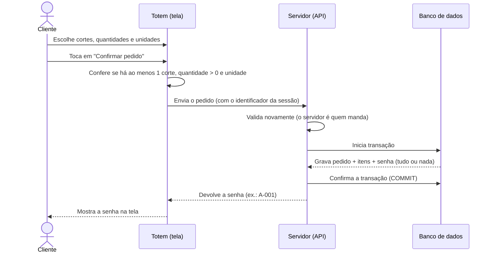

# Ao Ponto — Iteração 1: Registro de pedido (modo online)

Sistema inteligente de pedidos para açougues, desenvolvido como projeto acadêmico (Soluções Computacionais - UCB, 2026/2 — Grupo 3: Cássio Araújo e Gustavo Lima).

Este documento descreve **o que foi entregue na Iteração 1**, **como o sistema funciona** e **como testá-lo passo a passo**.

---

## Sumário

1. [O que é o Ao Ponto](#1-o-que-é-o-ao-ponto)
2. [O que esta iteração entrega (e o que não entrega)](#2-o-que-esta-iteração-entrega-e-o-que-não-entrega)
3. [Como o sistema funciona](#3-como-o-sistema-funciona)
4. [Guia de teste](#4-guia-de-teste)
5. [Checklist de aceitação](#5-checklist-de-aceitação)
6. [Problemas comuns](#6-problemas-comuns)
7. [Informações técnicas](#7-informações-técnicas)

---

## 1. O que é o Ao Ponto

Em açougues, o atendimento costuma ser feito inteiramente no balcão: os pedidos são organizados de forma verbal, e clientes com pedidos simples esperam tanto quanto clientes com pedidos grandes.

O Ao Ponto resolve isso com:

- um **totem de autoatendimento**, onde o cliente monta o pedido e recebe uma senha;
- um **painel de atendimento**, onde o funcionário vê os pedidos agrupados por corte de carne (futuro);
- um **painel de senhas**, onde o cliente acompanha a chamada (futuro).

A entrega do MVP é dividida em três iterações. **Esta é a primeira.**

---

## 2. O que esta iteração entrega (e o que não entrega)

### Entregue na Iteração 1

O cliente, no **totem**:

1. vê o cardápio de cortes de carne;
2. escolhe um ou mais cortes;
3. informa **quantidade** (digitando no campo ou usando os botões **+** e **−**) e **unidade de medida** (peça, pedaço, fatia ou gramas) de cada corte;
4. confirma o pedido;
5. recebe uma **senha de atendimento** (ex.: `A-001`).

O sistema garante que:

| Regra | O que significa na prática |
|---|---|
| **RN-001** | Cada sessão do totem gera no máximo um pedido. Enviar o mesmo pedido duas vezes não cria duplicidade. |
| **RN-004** | A senha só aparece depois que o pedido foi gravado com segurança no banco de dados. Se a gravação falhar, nenhuma senha é emitida. |
| **RN-006** | Não é possível confirmar um pedido vazio ou com quantidade zero. A quantidade aceita é um número inteiro de 1 a 99999. |
| **RN-007** | Todo corte escolhido precisa de quantidade e unidade de medida. |
| **RNF-001** | O registro do pedido leva até 2 segundos (em 95% dos casos). |

### Fica para as próximas iterações

| Item | Quando |
|---|---|
| Funcionamento do totem sem conexão com o servidor e sincronização (senha provisória) | Iteração 2 |
| Fila agrupada por corte, painel do funcionário, conclusão do pedido e chamada de senha | Iteração 3 |

> Por isso, nesta iteração, **ainda não existe tela para o funcionário nem painel de senhas**. A verificação do pedido gravado é feita consultando o banco de dados, com um comando pronto neste guia.
>
> Dos critérios da US01, valem para esta iteração os critérios 1 e 2 (e a parte do critério 4 que trata de reenvio, coberta pelo teste da RN-001). O critério 3 (senha provisória offline) será verificado na Iteração 2.

### 2.1 Cardápio disponível (carga inicial)

Como o cadastro de cortes pelo gerente (US06) está fora do MVP, o cardápio é carregado automaticamente na criação do banco:

Picanha, Alcatra, Fraldinha, Contrafilé, Coxão mole, Patinho, Maminha, Acém, Costela e Linguiça toscana.

---

## 3. Como o sistema funciona

### 3.1 Componentes

O sistema é composto por três containers Docker, iniciados juntos com um único comando:

| Componente | Função | Endereço |
|---|---|---|
| **Frontend** (tela do totem) | Interface com o cliente. React. | http://localhost:5173 |
| **Backend** (servidor / API) | Recebe o pedido, aplica as regras e grava. Node.js. | http://localhost:3000 |
| **Banco de dados** | Guarda cortes, pedidos e senhas. PostgreSQL. | (interno) |

### 3.2 O caminho de um pedido



Pontos importantes:

- **"Tudo ou nada" (transação):** pedido, itens e senha são gravados juntos. Se qualquer parte falhar, **nada** fica gravado e **nenhuma senha** é mostrada (RN-004).
- **Identificador da sessão:** cada atendimento no totem recebe um código único assim que começa. Se o mesmo pedido chegar duas vezes ao servidor (por exemplo, por falha de rede), o servidor reconhece o código e devolve o pedido já existente, sem criar outro (RN-001).
- **Dupla validação:** a tela avisa o cliente imediatamente, e o servidor valida de novo. Assim, mesmo que alguém tente burlar a tela, regras como "quantidade maior que zero" continuam valendo.
- **Campo de quantidade:** aceita apenas números (letras, vírgulas e sinais são ignorados) e no máximo 5 dígitos. Em telas de toque, abre o teclado numérico. Quando a unidade escolhida é **Gramas**, os botões **+** e **−** variam de 100 em 100; nas demais unidades, de 1 em 1.

### 3.3 O que fica guardado no banco

| Tabela | Conteúdo |
|---|---|
| `corte` | Os cortes do cardápio |
| `pedido` | Um registro por pedido (com o identificador único da sessão, o status e o horário) |
| `item_pedido` | Cada corte do pedido, com quantidade e unidade de medida |
| `senha_atendimento` | A senha do pedido (série `A` + número sequencial) |

---

## 4. Guia de teste

Tempo estimado: **30 a 40 minutos** (a primeira execução pode demorar mais por causa dos downloads).

### 4.1 Pré-requisitos

- Computador com **Windows 10/11**, **macOS** ou **Linux**.
- Navegador **Google Chrome** ou **Microsoft Edge**.
- Conexão com a internet (apenas na primeira execução, para baixar as imagens do Docker).
- **Docker Desktop** instalado (passo a seguir).

### 4.2 Passo 1 — Instalar o Docker Desktop

O sistema roda em containers Docker, então não é necessário instalar Node.js nem PostgreSQL separadamente.

1. Acesse https://www.docker.com/products/docker-desktop/ e baixe a versão para o seu sistema.
2. Execute o instalador e aceite as opções padrão. No Windows, mantenha marcada a opção de usar o **WSL 2**.
3. Reinicie o computador, se for solicitado.
4. Abra o **Docker Desktop** e aguarde até ele indicar que está em execução (ícone da baleia, com a mensagem "Engine running" no canto inferior esquerdo).

> O Docker Desktop precisa continuar **aberto** durante todos os testes.

### 4.3 Passo 2 — Baixar o projeto

Escolha **uma** das opções:

- **Download direto:** na página do repositório no GitHub, clique no botão verde **Code → Download ZIP**. Extraia o arquivo para uma pasta (ex.: `Documentos\ao-ponto`).
- **Com Git:** `git clone <url-do-repositorio>`

Dentro da pasta extraída deve existir um arquivo chamado `docker-compose.yml`. É nessa pasta que os comandos a seguir devem ser executados.

### 4.4 Passo 3 — Abrir o terminal na pasta do projeto

- **Windows:** abra a pasta do projeto no Explorador de Arquivos, clique na **barra de endereço** (onde aparece o caminho da pasta), digite `powershell` e tecle **Enter**. O terminal abrirá já na pasta correta.
- **macOS:** abra o app **Terminal**, digite `cd ` (com espaço), arraste a pasta do projeto para dentro da janela e tecle Enter.

### 4.5 Passo 4 — Iniciar o sistema

No terminal, execute:

```bash
docker compose up --build
```

- Na primeira execução, aguarde alguns minutos enquanto o Docker baixa e prepara tudo. Vão aparecer muitas linhas de log. Isso é normal.
- O sistema está pronto quando aparecerem mensagens como:
  - `API ouvindo na porta 3000`
  - `Local: http://localhost:5173/`
- **Mantenha esse terminal aberto** durante os testes: é ele que mantém o sistema em execução.

Para conferir, abra no navegador **http://localhost:3000/api/saude**. Deve aparecer: `{"status":"ok"}`.

### 4.6 Passo 5 — Abrir o totem

Abra no navegador: **http://localhost:5173**

Você deve ver a tela "Monte seu pedido" com a lista de cortes.

---

### 4.7 Testes manuais (pela tela)

Cada teste indica o que fazer e o que deve acontecer. Registre o resultado na [checklist](#5-checklist-de-aceitação).

#### Teste 1 — Registrar um pedido com sucesso *(US01, critérios 1 e 2)*

1. Na tela do totem, toque em **Picanha**. O corte fica marcado e aparecem os controles de quantidade e unidade.
2. No campo de quantidade, toque e digite **2** (ou use os botões **+** e **−**).
3. Toque na unidade **Peça**.
4. (Opcional) Toque em **Linguiça toscana**, digite **500** no campo de quantidade e escolha a unidade **Gramas**.
5. Toque em **Confirmar pedido**.

**Resultado esperado:** abre uma tela com o texto "Pedido registrado!" e uma senha grande, por exemplo `A-001`. Anote a senha.

#### Teste 2 — Conferir que o pedido foi gravado *(US01 e RN-004)*

Como ainda não existe tela de funcionário, a conferência é feita diretamente no banco de dados. Em um **novo terminal** (mantenha o primeiro aberto), na mesma pasta do projeto, execute:

```bash
docker compose exec db psql -U aoponto -d aoponto -c "SELECT s.serie || '-' || lpad(s.numero::text, 3, '0') AS senha, c.nome AS corte, i.quantidade, i.unidade, p.status FROM senha_atendimento s JOIN pedido p ON p.id = s.pedido_id JOIN item_pedido i ON i.pedido_id = p.id JOIN corte c ON c.id = i.corte_id ORDER BY s.numero DESC LIMIT 5;"
```

**Resultado esperado:** uma tabela com o pedido que acabou de ser feito, com a **mesma senha** que apareceu na tela:

```
 senha |      corte       | quantidade | unidade | status
-------+------------------+------------+---------+----------
 A-001 | Picanha          |          2 | peca    | PENDENTE
 A-001 | Linguiça toscana |        500 | gramas  | PENDENTE
```

Tire um print dessa tabela: ele é a **evidência** do critério "a senha exibida corresponde a um pedido gravado".

#### Teste 3 — Bloqueio de pedido vazio *(RN-006)*

1. Toque em **Novo pedido** (ou recarregue a página).
2. Sem escolher nenhum corte, toque em **Confirmar pedido**.

**Resultado esperado:** aparece uma caixa vermelha com a mensagem "Selecione ao menos um corte." Nenhuma senha é gerada.

#### Teste 4 — Bloqueio de quantidade zero ou vazia *(RN-006)*

1. Toque em **Alcatra**.
2. No campo de quantidade, apague o valor e digite **0**.
3. Escolha a unidade **Peça**.
4. Toque em **Confirmar pedido**.

**Resultado esperado:** mensagem vermelha "Alcatra: informe uma quantidade maior que zero." Nenhuma senha é gerada.

5. Agora apague o campo e deixe-o **vazio**. Toque em **Confirmar pedido** novamente.

**Resultado esperado:** a mesma mensagem vermelha.

#### Teste 4-B — Campo de quantidade só aceita números *(RN-006)*

1. Toque em **Acém**.
2. No campo de quantidade, tente digitar letras, vírgula ou o sinal de menos (ex.: `ab,-`).

**Resultado esperado:** nada disso aparece no campo; apenas números são aceitos.

3. Digite uma sequência longa de números (ex.: `1234567890`).

**Resultado esperado:** o campo para em **5 dígitos** (`12345`).

#### Teste 5 — Unidade de medida obrigatória *(RN-007)*

1. Toque em **Fraldinha** (quantidade 1) e **não** escolha nenhuma unidade.
2. Toque em **Confirmar pedido**.

**Resultado esperado:** mensagem vermelha "Fraldinha: escolha a unidade de medida." Nenhuma senha é gerada.

#### Teste 6 — Falha na gravação não gera senha *(RN-004)*

Este teste simula uma queda do banco de dados.

1. Deixe a tela do totem aberta, com o cardápio já carregado. Escolha **Picanha**, quantidade 1, unidade **Peça**. **Ainda não confirme.**
2. No segundo terminal, **desligue o banco**:
```bash
   docker compose stop db
```
3. Na tela, toque em **Confirmar pedido**.

   **Resultado esperado:** após alguns segundos, aparece uma mensagem de erro em vermelho (ex.: "Erro interno ao registrar o pedido."). **Nenhuma senha aparece.**

4. **Religue o banco:**
```bash
   docker compose start db
```
   Aguarde cerca de 10 segundos.
5. Toque novamente em **Confirmar pedido** (sem alterar nada).

   **Resultado esperado:** agora o pedido é registrado e a senha aparece, e **só existe um pedido** no banco para essa sessão. Repita o comando do Teste 2 para conferir.

---

### 4.8 Teste automático (cobre várias regras de uma vez)

Alguns critérios exigem repetição ou medição de tempo, o que é impraticável manualmente. Para isso existe um script de verificação. Em um terminal na pasta do projeto, execute:

```bash
docker compose exec backend sh -c "npm run verificar | tee evidencias/iteracao1-relatorio.txt"
```

O script executa o fluxo real contra o sistema e mostra o resultado de cada verificação. **Resultado esperado:**

```
=== Verificação — Iteração 1 (registro de pedido online) ===

PASSOU  US01 (crit. 1 e 2) — senha exibida corresponde a pedido gravado (5/5 execuções)
PASSOU  RN-001 — mesma sessão enviada 2x gera um único pedido
PASSOU  RN-004 — falha simulada não emite senha nem deixa pedido gravado
PASSOU  RN-006 — pedido vazio e quantidade zero são bloqueados
PASSOU  RN-007 — item sem unidade de medida é bloqueado
PASSOU  RNF-001 — 95% dos 30 registros em até 2 s

Todas as verificações passaram.
```

O que cada linha comprova:

| Verificação | O que o script faz |
|---|---|
| **US01** | Registra 5 pedidos e confere se a senha devolvida é a mesma gravada no banco |
| **RN-001** | Envia o **mesmo** pedido duas vezes e confere que existe apenas **um** registro no banco, com a mesma senha |
| **RN-004** | Força uma falha no meio da gravação e confere que não ficou pedido nem senha |
| **RN-006** | Tenta registrar pedido vazio e com quantidade 0 |
| **RN-007** | Tenta registrar um item sem unidade de medida |
| **RNF-001** | Faz 30 registros cronometrados e confere se ao menos 95% levam até 2 segundos |

**Evidências geradas** (dentro da pasta do projeto, em `backend/evidencias/`):

- `iteracao1-relatorio.txt` — o resultado acima, em texto;
- `iteracao1-desempenho.csv` — o tempo de cada um dos 30 registros (abre no Excel).

> Essa pasta é criada no computador de quem executa o teste e não vem no GitHub.

> **Nota sobre o teste de falha (RN-004):** o sistema só aceita o comando de "falha simulada" porque este ambiente de teste está configurado com `PERMITIR_SIMULACAO=true`. Em produção essa opção fica desligada.

---

### 4.9 Encerrar o sistema

No terminal onde o sistema está rodando, tecle **Ctrl + C**. Depois execute:

```bash
docker compose down
```

Os pedidos de teste continuam guardados para a próxima execução. Para **apagar tudo e começar do zero** (banco limpo e senhas voltando para `A-001`):

```bash
docker compose down -v
```

---

## 5. Checklist de aceitação

Registre o resultado de cada item. As linhas correspondem à Matriz de Verificação e Aceitação da Iteração 1 (Documento de Requisitos, Seção 2.2).

| # | Requisito | Teste | Resultado esperado | PASSOU / FALHOU | Observações |
|---|---|---|---|---|---|
| 1 | US01 (crit. 1 e 2) | Teste 1 e Teste 2 | Senha exibida corresponde a pedido gravado no banco | | |
| 2 | US01 (crit. 1 e 2) | Script (4.8) | 5/5 execuções corretas | | |
| 3 | RN-001 | Script (4.8) | Pedido enviado 2x gera 1 registro | | |
| 4 | RN-004 | Teste 6 e Script (4.8) | Nenhuma senha emitida sem gravação | | |
| 5 | RN-006 | Testes 3, 4 e 4-B e Script (4.8) | Pedido vazio e quantidade 0 ou vazia bloqueados; campo só aceita números (até 5 dígitos) | | |
| 6 | RN-007 | Teste 5 e Script (4.8) | Item sem unidade bloqueado | | |
| 7 | RNF-001 | Script (4.8) | ≥ 95% dos 30 registros em até 2 s | | |

**Condição de conclusão da Iteração 1:** todos os itens acima marcados como PASSOU e as evidências (prints do Teste 2, relatório e CSV) anexadas ao relatório de testes de aceitação.

---

## 6. Problemas comuns

| Sintoma | O que fazer |
|---|---|
| `docker: command not found` ou "Cannot connect to the Docker daemon" | O Docker Desktop não está aberto. Abra-o e aguarde "Engine running". |
| Erro de porta em uso (`port is already allocated`) | Outro programa usa a porta 3000, 5173 ou 5432. Feche-o ou altere o mapeamento de portas no `docker-compose.yml`. |
| A página http://localhost:5173 não abre | Aguarde 1 a 2 minutos após o comando de subir. Confira se o terminal mostra `Local: http://localhost:5173/`. |
| A página abre, mas a lista de cortes não aparece | Veja se http://localhost:3000/api/saude responde `{"status":"ok"}`. Se não, execute `docker compose logs backend` e verifique a mensagem de erro. |
| Depois do Teste 6, o pedido continua dando erro | Aguarde mais alguns segundos após `docker compose start db` e tente de novo. Se persistir: `docker compose restart backend`. |
| Quero recomeçar do zero | `docker compose down -v` e depois `docker compose up --build`. |
| Quero ver o que o sistema está registrando | `docker compose logs -f backend` (Ctrl + C para sair). |

---

## 7. Informações técnicas

### 7.1 Tecnologias

| Camada | Tecnologia |
|---|---|
| Frontend | React 19.2.0 + Vite |
| Backend | Node.js 22 + Express 5.1.0 |
| Banco de dados | PostgreSQL 17.5 |
| Infraestrutura | Docker Compose (3 containers: `frontend`, `backend`, `db`) |

### 7.2 Estrutura do repositório

```
ao-ponto/
├─ docker-compose.yml          # sobe os 3 containers
├─ db/init/
│  ├─ 01-schema.sql            # criação das tabelas
│  └─ 02-seed.sql              # carga inicial do cardápio
├─ backend/
│  ├─ src/
│  │  ├─ index.js              # inicialização do Express e tratamento de erros
│  │  ├─ db.js                 # conexão com o PostgreSQL
│  │  ├─ validacao.js          # validação do pedido (RN-006, RN-007)
│  │  ├─ routes/               # rotas HTTP (cortes e pedidos)
│  │  └─ services/pedidoService.js   # transação única + idempotência (RN-001, RN-004)
│  └─ scripts/verificar-iteracao1.mjs  # verificação automática
└─ frontend/
   └─ src/
      ├─ App.jsx               # controle de tela e do identificador de sessão
      ├─ api.js                # chamadas ao backend
      └─ telas/                # TelaPedido e TelaSenha
```

### 7.3 API

| Método | Rota | Descrição |
|---|---|---|
| GET | `/api/saude` | Verifica se o servidor e o banco respondem |
| GET | `/api/cortes` | Lista os cortes disponíveis |
| POST | `/api/pedidos` | Registra um pedido |

`POST /api/pedidos` — corpo:

```json
{
  "sessaoId": "uuid-gerado-no-totem",
  "criadoEm": "2026-10-10T14:30:00.000Z",
  "itens": [
    { "corteId": 1, "quantidade": 2, "unidade": "peca" }
  ]
}
```

Unidades válidas: `peca`, `pedaco`, `fatia`, `gramas`. A `quantidade` deve ser um número inteiro entre 1 e 99999.

| Status | Significado |
|---|---|
| `201` | Pedido criado. Devolve `pedidoId`, `sessaoId`, `status` e `senha` |
| `200` | Sessão já tinha pedido (reenvio): devolve o mesmo registro, sem duplicar (RN-001) |
| `422` | Validação falhou (RN-006/RN-007): devolve `{ "erros": [...] }` |
| `500` | Falha na gravação: nada foi gravado e nenhuma senha foi emitida (RN-004) |

### 7.4 Decisões de projeto desta iteração

- **Transação única** (`BEGIN`/`COMMIT`) para pedido, itens e senha; a senha só é devolvida após o `COMMIT`.
- **Idempotência** pela restrição `UNIQUE` em `pedido.sessao_id` com `INSERT ... ON CONFLICT DO NOTHING`, que também protege contra requisições simultâneas.
- **Senha online** com série `A` e numeração por sequência do PostgreSQL. A série `P` fica reservada para a senha provisória offline (Iteração 2). A sequência não reinicia por dia nesta versão.
- **Identificador de sessão** gerado no totem ao iniciar o atendimento (e não ao confirmar), preparando o reenvio seguro da Iteração 2.
- **Quantidade digitável:** o campo guarda o valor como texto na tela (para poder ficar vazio durante a digitação) e converte para número só na confirmação. Aceita apenas dígitos, com limite de 5 (máx. 99999), validado também no servidor para devolver `422` em vez de erro do banco. O passo dos botões **+/−** é 100 para gramas e 1 para as demais unidades.
- **Simulação de falha** (`x-simular-falha`) habilitada apenas com `PERMITIR_SIMULACAO=true`, para tornar a RN-004 verificável.
- **Painel e totem sem login** nesta fase; o acesso restrito à rede local (RNF-008) entra na Iteração 3.

### 7.5 Credenciais de desenvolvimento do banco

Usuário `aoponto`, senha `aoponto`, banco `aoponto`, porta `5432`. **Somente para desenvolvimento local.**

---

## Próximas iterações

- **Iteração 2:** operação offline do totem (armazenamento local, senha provisória, sincronização sem duplicidade).
- **Iteração 3:** fila agrupada por corte, painel de atendimento com atualização automática, conclusão do pedido e chamada de senha.